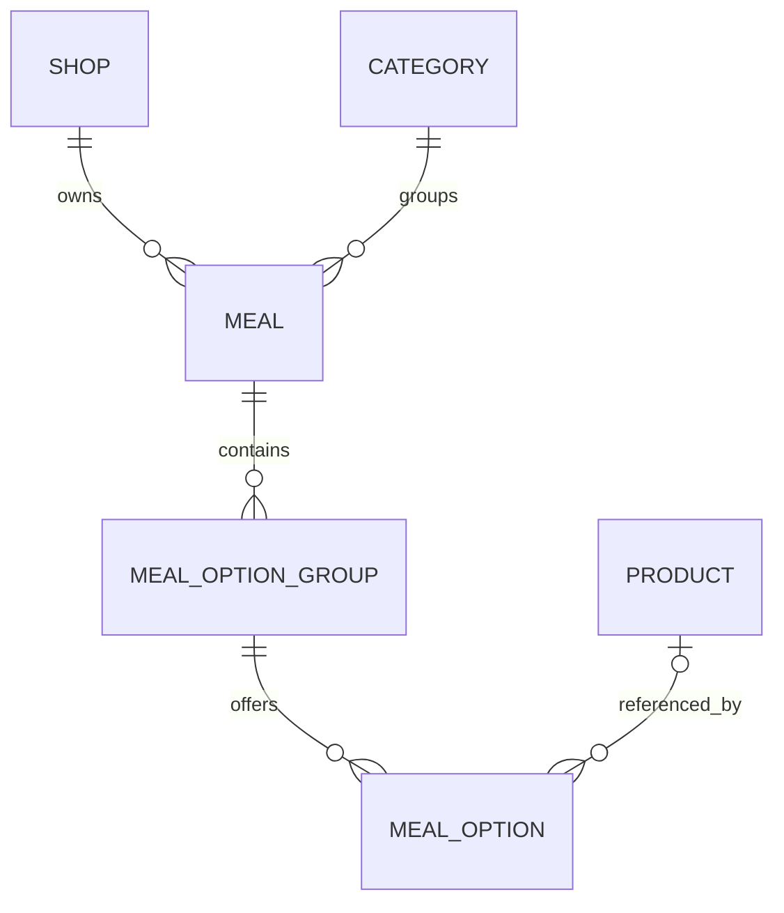

# Meal Model Draft

| Field | Value |
|---|---|
| Created / updated | 3 November 2026 / 4 November 2026 |
| Milestone | M3 — configurable meals |
| Status | Completed logical draft based on accepted rules; physical schema and APIs pending |
| Business rules | [ADR-002](../Decisions.md#adr-002--bounded-meal-selections-and-independent-supplements) |
| Option design | [ADR-003](../Decisions.md#adr-003--product-backed-meal-options-and-explicit-non-product-choices) |
| Category placement | [ADR-004](../Decisions.md#adr-004--reuse-shop-categories-for-meals) |
| Existing schema | [Data Model](./Data%20Model.md) |

This document describes the current logical model. Field names are implementation proposals consistent with the accepted ADRs; SQL types, indexes, constraints and migrations are not yet implemented. Examples use hypothetical Shop 1 records, not existing seed IDs. Confirmed changes should update this document; record important changed decisions and rationale in the ADRs.

## 1. Entity responsibilities

| Entity | Responsibility | Example |
|---|---|---|
| Meal | A shop-owned purchasable bundle with a base price and required choices | Lunch Meal, HK$58 |
| MealOptionGroup | One required choice within one meal, with exactly one option selected | Main or Drink |
| MealOption | One allowed choice in one group, with its own supplement and availability | Coffee +HK$3 in Lunch Meal's Drink group |
| Product | Existing shop-owned product supplying its current name, standalone price and availability | Coffee sold separately for HK$28 |

An option does not copy the standalone price into its supplement. Several options may reference the same product but carry different supplements.

## 2. Relationships

| From | To | Cardinality / optionality | Meaning |
|---|---|---|---|
| Shop | Meal | One to zero or many | Every meal has exactly one owning shop |
| Category | Meal | One to zero or many | Every meal belongs to exactly one same-shop category; categories may contain products and meals |
| Meal | MealOptionGroup | One to zero or many during setup | Each group belongs to exactly one meal; a purchasable meal must contain at least one complete required group |
| MealOptionGroup | MealOption | One to zero or many during setup | Every option belongs to exactly one group; purchasing requires an available selection in every group |
| MealOption | Product | Zero or one | Product-backed choices reference one product; explicit non-product choices reference none |
| Product | MealOption | One to zero or many | A product may be offered by several groups/meals |

The diagram permits incomplete saved records during setup. Storage existence and purchase eligibility are different concerns: effective meal availability must also enforce required-group completeness. The administration publication workflow remains to be specified.

## 3. Logical fields

All IDs identify records; they are not ownership proof. Requiredness below describes the logical model, not final SQL declarations. Additional ownership columns may be included in physical schema design to support composite foreign keys.

### 3.1 Meal

| Field | Purpose / reference | Required? | Example |
|---|---|---|---|
| id | Meal identity | Yes | 1000 |
| shop_id | Owning Shop | Yes | 1 |
| category_id | Existing same-shop Category | Yes | 3100 |
| name | Meal display name | Yes, nonblank | Lunch Meal |
| base_price | HKD price before supplements | Yes, nonnegative, at most two fractional digits | 58.00 |
| status | Administrator-controlled availability | Yes | AVAILABLE / UNAVAILABLE |

Meals reuse existing Category records (ADR-004). Referenced products may be in different categories of the same shop. Meal status alone cannot override incomplete groups or unavailable choices.

### 3.2 MealOptionGroup

| Field | Purpose / reference | Required? | Example |
|---|---|---|---|
| id | Group identity | Yes | 1100 |
| meal_id | Parent Meal | Yes | 1000 |
| name | Choice label | Yes, nonblank | Main |
| sort_order | Display ordering within its meal | Yes; proposed nonnegative, default 0 | 10 |

Exactly-one selection is fixed by ADR-002, so no configurable minimum/maximum selection fields are needed. Proposed deterministic ordering: sort_order ascending, then id ascending. Ordering numbers need not be unique.

### 3.3 MealOption

| Field | Purpose / reference | Required? | Example |
|---|---|---|---|
| id | Option identity; client selects this ID | Yes | 1200 |
| group_id | Parent MealOptionGroup | Yes | 1100 |
| product_id | Product supplying current name/availability | Optional; determines product-backed versus non-product case | 3000 or null |
| label | Display text for a non-product choice | Required and nonblank without product_id; otherwise absent | No Drink |
| supplement | HKD addition to meal base price | Yes; nonnegative, at most two fractional digits; zero for non-product choice | 3.00 |
| status | Availability specific to this option | Yes | AVAILABLE / UNAVAILABLE |
| sort_order | Display ordering within its group | Yes; proposed nonnegative, default 0 | 10 |

For product-backed options, use the referenced product's name. Proposed option ordering follows the same sort_order/id rule as groups. No standalone price or client-supplied total belongs on an option.

## 4. Consistency and eligibility rules

| Situation | Rule | Intended enforcement |
|---|---|---|
| Product-backed option | Existing same-shop product reference; label absent; independent nonnegative supplement | FK/conditional constraints where applicable, plus application validation |
| Non-product option | product_id null, nonblank label, supplement zero | Conditional DB checks plus application validation |
| Ownership | Group inherits meal ownership; option inherits group ownership; product, if present, must have the same shop | Application checks and proposed composite FKs; exact columns pending |
| Product UNAVAILABLE, option AVAILABLE | Choice cannot be selected | Application eligibility calculation |
| Product AVAILABLE, option UNAVAILABLE | Choice cannot be selected | Application eligibility calculation |
| Non-product choice | Its own status governs availability, subject to meal/group rules | Application eligibility calculation |
| Required group has no available option | Meal cannot be purchased | Application validation, regardless of stored meal status |
| Submitted selections | Exactly one distinct option per required group; every option belongs to the requested group/meal; no cross-shop references | Application validation |
| Pricing | Server uses current meal base price and selected supplements; quantity 1–99 | Application validation and exact decimal arithmetic |
| Saved setup is incomplete | May be represented while constructing a meal; must never pass purchase eligibility | Administration workflow design and application validation |

Product availability propagation is calculated from current product state; this model does not require mass-updating every referencing option when a product becomes unavailable. Later orders preserve purchased snapshots rather than resolving historical names/prices from live menu data.

## 5. Worked records

All records below belong to hypothetical Shop 1. They do not reference Shop 2's existing coffee fixture.

### Products

| Product ID | Shop ID | Name | Standalone price | Status |
|---|---|---|---|---|
| 3000 | 1 | Chicken Rice | 58.00 | AVAILABLE |
| 3001 | 1 | Beef Rice | 63.00 | AVAILABLE |
| 3002 | 1 | Hot Tea | 15.00 | AVAILABLE |
| 3003 | 1 | Iced Tea | 18.00 | AVAILABLE |
| 3004 | 1 | Coffee | 28.00 | AVAILABLE |

Standalone prices are illustrative; none is used as a meal supplement. Products also require an existing same-shop category under the current product schema; those category IDs are omitted from this logical example, which is not executable seed SQL.

### Meal

| Meal ID | Shop ID | Category ID | Name | Base price | Status |
|---|---|---|---|---|---|
| 1000 | 1 | 3100 | Lunch Meal | 58.00 | AVAILABLE |

Category 3100 is a hypothetical Shop 1 category named Lunch Meals; it uses the existing category model.

### Groups

| Group ID | Meal ID | Name | Sort order |
|---|---|---|---|
| 1100 | 1000 | Main | 10 |
| 1101 | 1000 | Drink | 20 |

### Options

| Option ID | Group ID | Product ID | Non-product label | Supplement | Status | Sort order |
|---|---|---|---|---|---|---|
| 1200 | 1100 | 3000 | null | 0.00 | AVAILABLE | 10 |
| 1201 | 1100 | 3001 | null | 5.00 | AVAILABLE | 20 |
| 1202 | 1101 | 3002 | null | 0.00 | AVAILABLE | 10 |
| 1203 | 1101 | 3003 | null | 2.00 | AVAILABLE | 20 |
| 1204 | 1101 | 3004 | null | 3.00 | AVAILABLE | 30 |
| 1205 | 1101 | null | No Drink | 0.00 | AVAILABLE | 40 |

### Selections and totals

| Configuration | Selected option IDs | Quantity | Unit-price calculation | Line total |
|---|---|---|---|---|
| Chicken Rice + Coffee | 1200, 1204 | 1 | 58 + 0 + 3 = 61.00 | 61.00 |
| Beef Rice + Iced Tea | 1201, 1203 | 2 | 58 + 5 + 2 = 65.00 | 130.00 |
| Chicken Rice + No Drink | 1200, 1205 | 1 | 58 + 0 + 0 = 58.00 | 58.00 |

If Coffee product 3004 becomes unavailable, option 1204 cannot be selected; its supplement remains 3.00 and other available Drink choices remain usable. If all Drink options, including No Drink, become unavailable, Lunch Meal cannot be purchased.

## 6. Open design work

| Question | Proposal / next action | Status |
|---|---|---|
| How will meals appear under categories? | Reuse Category; exactly one same-shop category per meal; see ADR-004 | Resolved 4 November 2026 |
| Ownership columns and composite constraints | Choose physical columns after logical review; enforce option/product same-shop consistency rather than relying on independent FKs | Schema design pending |
| Monetary storage and overflow | Choose precision and maximum supported base/supplement/unit/line totals; ADR only fixes scale, arithmetic and quantity bounds | Schema/API design pending |
| Administration and publication | Define safe setup flow and purchase eligibility for incomplete meals; stored AVAILABLE is not sufficient | API design pending |
| Menu response compatibility | Decide how meals are exposed alongside existing products without silently breaking M1 responses | API design pending |

## 7. Review record

On 4 November 2026 the assistant completed this logical draft from accepted ADR-002/003 at Pluto's request. Examples and relationships were checked for same-shop membership, correct group references and the documented totals. No schema migration or application implementation is claimed. Draft field choices and open items still require physical/API design review.

Category placement was confirmed in ADR-004 on 4 November 2026. Physical details are proposed in [Meal Schema Proposal](./Meal%20Schema%20Proposal.md); they are not an applied migration.
